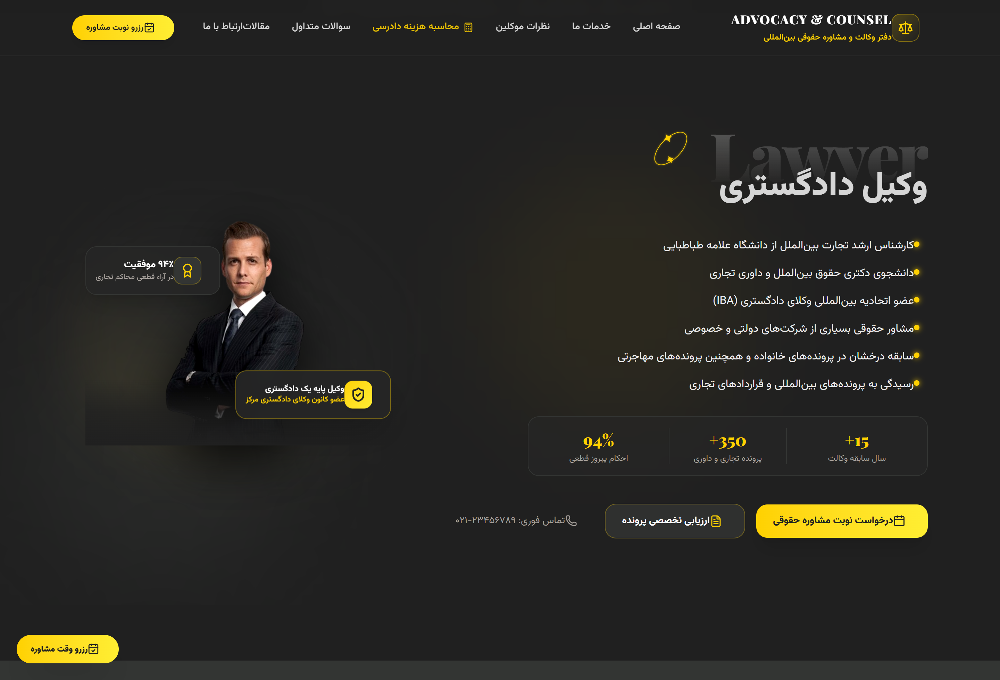
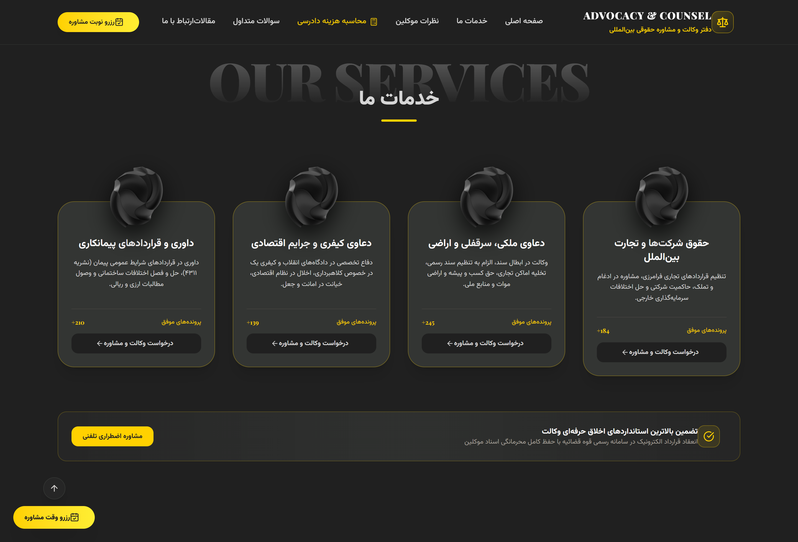
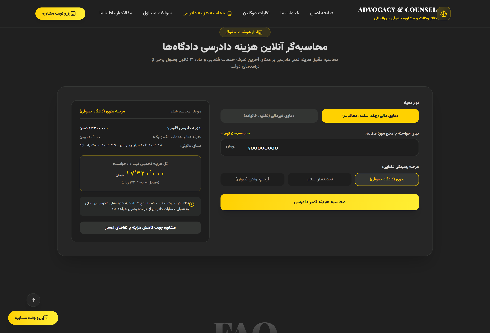
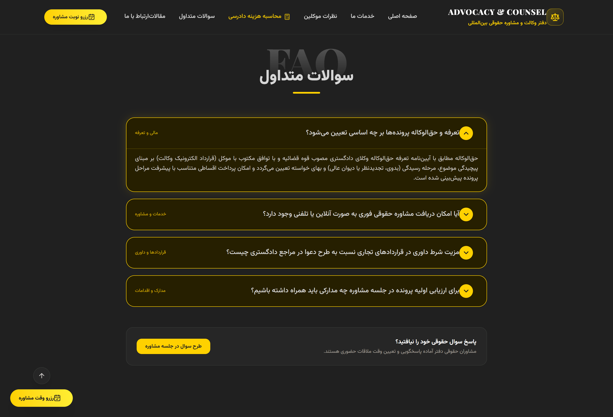
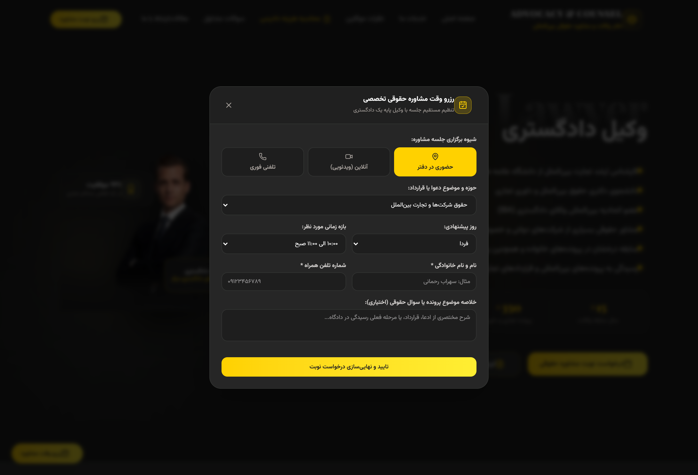
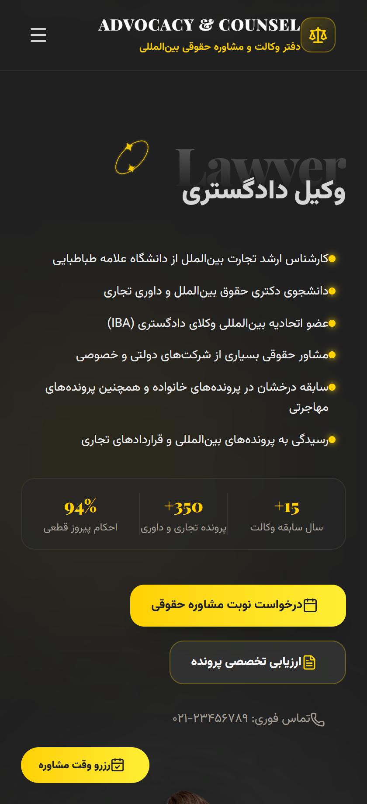

# Vakil - International Law Firm & Legal Counsel Platform

A production-grade, full-stack legal counsel and attorney platform engineered with React 19, Tailwind CSS v4, and Django REST Framework. Developed from the ground up based on the premium Iranian legal UI/UX kit on Figma.

[Live Demo](https://lxlnimalxl.github.io/vakil-legal-platform/) | [Frontend Architecture](#frontend-architecture) | [Backend REST API](#backend-rest-api) | [Getting Started](#getting-started)

---

## Visual Showcase

### Desktop Hero & Attorney Credentials


### Practice Areas (3D Metallic Elements)


### Interactive Court Fee Calculator


### FAQ Accordion & Client Testimonials


### Consultation Booking Modal


### Mobile Responsive Interface


---

## Architectural Highlights

### Frontend
- **React 19 & Vite 8**: Modern component architecture, reactive state management, and optimized asset pipelines.
- **Tailwind CSS v4 & Vazirmatn Typography**: Strict RTL design system matching original Persian typographic hierarchy and spacing scales.
- **Visual Design from Figma**: High-profile luxury aesthetic utilizing charcoal `#202020`, deep graphite `#333533`, metallic gold `#FFD100`, and silver `#D6D6D6`.
- **Interactive Court Fee Calculator**: Real-time legal calculator implementing the Iranian Civil Procedure Code (ماده ۳ قانون وصول برخی از درآمدهای دولت) for first instance, appellate, and supreme court stages.
- **Consultation Booking Engine**: Multi-mode appointment booking (in-person office, video conference, emergency phone call) with celebratory confetti.
- **Case Evaluation System**: Confidential dispute evaluation request with urgency metrics.
- **Client Testimonials & Brands Carousel**: Authentic polygon cut-corner container and corporate client logos (Golrang, Mapna, Digikala, Snapp, MCI).
- **Hybrid API Layer**: Seamlessly queries Django REST API when running with local server, while gracefully falling back to deterministic local mock data on static GitHub Pages.

### Backend
- **Python 3.13 & Django 5.2**: Clean MVC/MVT architecture, declarative ORM models, and secure defaults.
- **Django REST Framework (DRF)**: Standard RESTful endpoints for services, bookings, case evaluations, articles, testimonials, and FAQs.
- **Automated Data Seeding Engine**: `python manage.py seed` command populates realistic Iranian legal practice areas, verified client reviews, authoritative legal articles, and FAQs.
- **CORS & API Security**: Configured with `django-cors-headers` to support distributed frontend deployment.

---

## Technology Stack

| Layer | Technologies |
|---|---|
| **Frontend** | React 19, Vite 8, Tailwind CSS v4, Lucide React, Canvas Confetti |
| **Backend** | Python 3.13, Django 5.2, Django REST Framework, SQLite |
| **Typography** | Vazirmatn, Playfair Display, Cinzel, Plus Jakarta Sans |
| **Design Source** | Figma UI/UX Kit (Website lawyer / سایت وکیل | سایت وکالت) |
| **Deployment** | GitHub Pages (Frontend static client), Gunicorn / WSGI ready (Django) |

---

## Repository Structure

```text
n11/
├── backend/
│   ├── api/
│   │   ├── migrations/
│   │   ├── management/commands/seed.py
│   │   ├── models.py
│   │   ├── serializers.py
│   │   ├── urls.py
│   │   └── views.py
│   ├── core/
│   │   ├── settings.py
│   │   ├── urls.py
│   │   └── wsgi.py
│   ├── manage.py
│   └── requirements.txt
├── screenshots/
│   ├── 01-desktop-hero-overview.png
│   ├── 02-services-grid.png
│   ├── 03-court-fee-calculator.png
│   ├── 04-faq-and-testimonials.png
│   ├── 05-consultation-booking-modal.png
│   └── 06-mobile-responsive-view.png
├── src/
│   ├── assets/
│   │   ├── images/
│   │   ├── sparkle.svg
│   │   └── star-emblem.svg
│   ├── components/
│   │   ├── home/
│   │   ├── layout/
│   │   └── modals/
│   ├── services/
│   ├── App.jsx
│   ├── index.css
│   └── main.jsx
├── index.html
├── package.json
└── vite.config.js
```

---

## Getting Started

### 1. Frontend Setup

```bash
# Clone the repository
git clone https://github.com/lxlnimalxl/vakil-legal-platform.git
cd vakil-legal-platform

# Install dependencies
npm install

# Start development server
npm run dev

# Build production bundle
npm run build
```

### 2. Backend Setup (Django REST API)

```bash
cd backend

# Create and activate virtual environment (optional)
python -m venv venv
source venv/bin/activate  # On Windows: venv\Scripts\activate

# Install requirements
pip install -r requirements.txt

# Run migrations and seed authentic demo legal data
python manage.py migrate
python manage.py seed

# Start API server on port 8000
python manage.py runserver 8000
```

The REST API endpoints will be accessible at:
- `GET /api/services/` - List practice areas
- `POST /api/consultations/` - Book consultation appointment
- `POST /api/cases/` - Submit case evaluation request
- `GET /api/articles/` - Legal insights articles
- `GET /api/testimonials/` - Client reviews
- `GET /api/faqs/` - Frequently asked questions
- `POST /api/calculate-court-fee/` - Calculate court filing fee

---

## License & Credits

- Designed from Figma Community Kit: *Website lawyer | سایت وکیل | سایت وکالت*.
- Developed by **Seyyed Nima Rounaghi** ([@lxlnimalxl](https://github.com/lxlnimalxl)).
